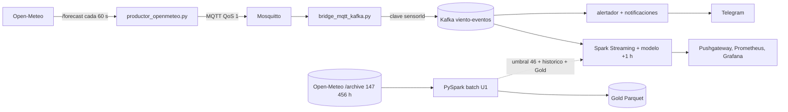

# Arquitectura

Arquitectura **Lambda**: una capa *batch* (U1) con el pasado y una capa de *velocidad* (U2) con el presente, unidas por tres puentes.

## Decisiones técnicas
| Decisión | Razón |
|---|---|
| MQTT QoS 1 con Mosquitto propio | Entrega al menos una vez, sin depender de un broker externo |
| Kafka con 3 particiones y clave `sensorId` | Orden por estación y paralelismo |
| Auto-creación de topics desactivada | Los topics se crean de forma explícita y repetible |
| Watermark 2 min y dedup `(sensorId, obsTime)` | Tolerar dato tardío y mensajes repetidos |
| Pushgateway | Los procesos cortos (notebooks) no pueden ser consultados por Prometheus |
| Healthchecks + `service_healthy` | Un servicio no arranca antes de que su dependencia esté lista |

## Los tres puentes U1 → U2
1. **Umbral 46 km/h:** `umbral_viento.json` → `UMBRAL_RAFAGA_KMH` (compose) → `comun.py` → alertador.
2. **Histórico horario:** entrena el modelo +1 h (notebook 10).
3. **Gold:** alimenta los KPIs batch de Grafana (notebook 11).

!!! note "Qué no se usa en vivo"
    Los modelos de la U1 (`modelo_rafaga_u1`, `modelo_dia_fuerte_u1`) no corren en tiempo real. El alertador usa la ráfaga observada, no la predicción.

## Carpetas
`pyspark/sesiones` (notebooks) · `uso-viento/app` (productor, puente, consumidores) · `kafka/` · `obs/` (Prometheus, Grafana) · `scripts/` · `docs/`.
