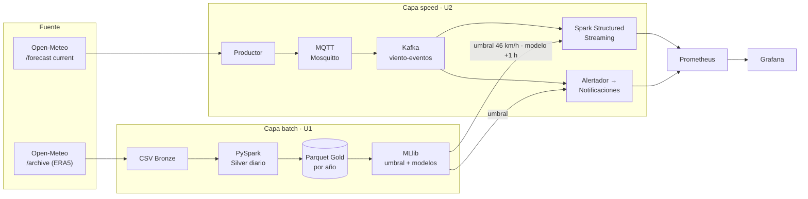
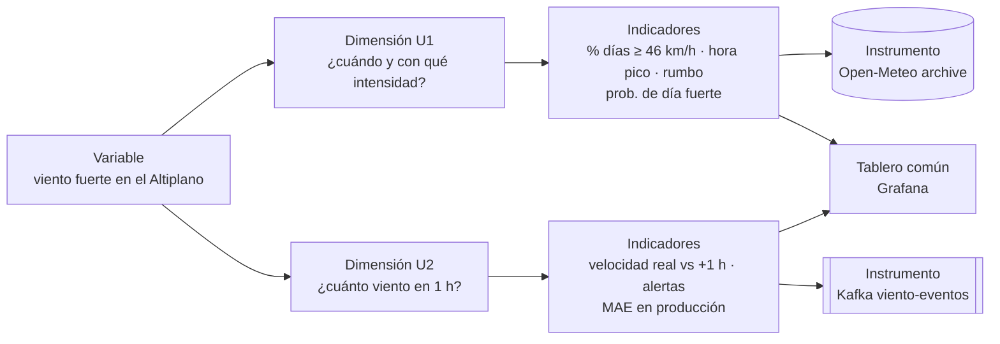

# Brief técnico-analítico

!!! abstract "Resumen ejecutivo"
    **ClimateRisk Andes · Viento** es un sistema Big Data con arquitectura **Lambda** que anticipa el **viento fuerte** en el Altiplano de Juliaca.
    La capa **batch** (U1) procesa 16 años de datos horarios con PySpark y define qué es un día de viento fuerte (**≥ 46 km/h**, percentil 90).
    La capa **speed** (U2) recibe el viento real cada 15 segundos por MQTT y Kafka, predice la **próxima hora** con un modelo Random Forest y **avisa a los productores suscritos** cuando la ráfaga supera el umbral.
    La **integración** (U3) empaqueta todo para que cualquier persona lo levante, lo verifique y lo opere siguiendo esta documentación.

| Campo | Valor |
|---|---|
| Versión del brief | **v3** · actualizado en noviembre de 2026 (ver [historial](#10-historial-de-versiones)) |
| Estado | U1 ✅ entregado · U2 ✅ entregado · U3 🛠️ en construcción |
| Documentos relacionados | [Producto U1](u1-producto.md) · [Producto U2](u2-producto.md) · [Contratos de eventos](contratos.md) |

!!! warning "Cambio de alcance · noviembre 2026"
    La dimensión pasa de **precipitación** a **viento**. En época seca la lluvia en vivo vale 0 casi todo el tiempo y no daba señal en streaming; el viento cambia siempre y la misma API lo entrega en tiempo real. El trabajo pasa a ser **individual** y se rehace desde cero en un repositorio propio.

---

## 1. Datos del equipo

| Campo | Valor |
|---|---|
| Nombre del equipo | No aplica: trabajo individual |
| Sección | ⟨completar⟩ |
| Repositorio | [github.com/kiohunter12/bigdata-viento-nayder](https://github.com/kiohunter12/bigdata-viento-nayder) |
| Documentación publicada | [kiohunter12.github.io/bigdata-viento-nayder](https://kiohunter12.github.io/bigdata-viento-nayder/) |
| Topics configurados | Sí · falta agregar `grupo-⟨número⟩-climaterisk-andes` |
| Docente | Abel Angel Sullon Macalupu |
| Curso | Big Data · Ingeniería de Sistemas · Universidad Peruana Unión · 2026-2 |

bigdatacampus-juliacasemestre-2026-2linea-cdiatipo-psseccion-⟨g⟩grupo-⟨n⟩-climaterisk-andes

| Integrante | Rol o énfasis | Aporte verificable |
|---|---|---|
| Efrain Nayder Arce Mayta | Extremo a extremo: batch con Spark (U1) · ingesta IoT, Kafka, streaming, observabilidad y BI/ML (U2) · integración y DataOps (U3) | Commits del repositorio, notebooks `01` y `08`–`11`, servicios de `uso-viento/`, tablero de Grafana y este sitio |

---

## 2. Dominio del proyecto

!!! question "Pregunta central de negocio"
    **¿Cuándo y con qué intensidad sopla el viento fuerte en el Altiplano de Juliaca, y cuánto viento habrá en la próxima hora para avisar a tiempo a los productores?**

Nombre del proyecto
:   ClimateRisk Andes · Viento

Problema que resuelve
:   En el Altiplano (Juliaca, Puno y Lampa) el viento fuerte rompe coberturas, daña cultivos y afecta el secado del chuño. Los productores no tienen un aviso local y oportuno: se enteran cuando el viento ya llegó.

Dominio de datos
:   Meteorología aplicada al agro: velocidad, dirección y ráfaga del viento a 10 m, más temperatura, humedad, presión y nubosidad.

Usuarios y actores
:   Ver la tabla siguiente.

| Actor | Qué necesita | Cómo usa el sistema |
|---|---|---|
| Productor agrícola suscrito | Saber si viene viento fuerte en su zona | Recibe el evento `alerta.notificada` con la estación y el nivel |
| Analista de riesgo / gestor local | Ver el estado del viento y la calidad del pronóstico | Tablero de Grafana *Viento Juliaca* (5 filas) |
| Planificador de labores | Elegir meses y horas con menos viento | Climatología de la U1: % de días fuertes por mes y hora pico |
| Sistema de alertas (automático) | Decidir cuándo avisar | Compara la ráfaga real con el umbral p90 = 46 km/h |

### Arquitectura: Lambda

| Criterio | Lambda (elegida) | Kappa (descartada) |
|---|---|---|
| Recalcular 16 años de histórico cuando cambia una regla | Se hace en batch, una vez | Habría que reprocesar todo por Kafka |
| Reutilizar el umbral y el modelo en tiempo real | El batch los produce y la capa speed los consume | Mezcla entrenamiento e inferencia en el mismo flujo |
| Complejidad | Dos caminos que mantener | Un solo camino |
| Encaje con el curso | U1 batch y U2 streaming por separado | No separa las unidades |

### Fuentes de datos

=== ":material-database: Batch"

    **API Open-Meteo · Historical Weather (reanálisis ERA5 de Copernicus/ECMWF)**

    | Campo | Valor |
    |---|---|
    | Punto | Juliaca (-15.50082, -70.13980) |
    | Frecuencia | Horaria, desde 2010-01-01 |
    | Volumen | **147 456** registros horarios → **6 144** días completos |
    | Variables | `fecha_hora`, `temperatura`, `humedad`, `presion`, `nubosidad`, `velocidad`, `direccion`, `rafaga` |
    | Acceso | Pública, sin API key · `requests.get` año por año con reintentos |

=== ":material-access-point: Tiempo real"

    **API Open-Meteo · Forecast con `current` (se recalcula cada 15 minutos)**

    | Campo | Valor |
    |---|---|
    | Puntos | Juliaca, Puno y Lampa (3 sensores virtuales) |
    | Frecuencia de consulta | Cada 15 s (configurable con `INTERVALO_S`) |
    | Camino | productor → MQTT (Mosquitto propio) → puente → Kafka `viento-eventos` |
    | Eventos IoT | `viento.lectura` v1 · key = `sensorId` · 3 particiones |
    | Eventos de negocio | `suscripcion.creada`, `alerta.emitida`, `alerta.notificada` en `alerta-eventos` |

!!! note "Mismo origen, dos momentos"
    Es la misma API vista en dos momentos: el histórico acumulado (batch) y la lectura del momento (streaming). No es una estación física: es el valor de un modelo meteorológico para la celda de cuadrícula de cada ciudad, por eso se trata como un **sensor virtual**.

Continuidad
:   Continúa el proyecto **ClimateRisk Andes** de la U1 2026-2, desarrollado originalmente en el equipo BIG IMPACT (dimensión precipitación). Desde noviembre de 2026 se rehace de forma **individual**, con dimensión **viento**, en un repositorio y una arquitectura propios.

---

## 3. Dimensiones de análisis

### Matriz de operacionalización

### Tabla de asignación

| Integrante | Tipo | Dimensión (como pregunta) | Indicador | Fuente batch | Fuente streaming |
|---|---|---|---|---|---|
| Efrain Nayder Arce Mayta | **Predictiva U1** · batch | ¿En qué meses, horas y desde qué dirección sopla más fuerte el viento, y se puede estimar la ráfaga máxima de hoy con lo que pasó ayer? | % de días con ráfaga ≥ 46 km/h por mes · hora pico · rumbo dominante · probabilidad de día fuerte | Open-Meteo archive horario | No aplica |
| Efrain Nayder Arce Mayta | **Predictiva U2** · streaming | ¿Cuánto viento habrá en la próxima hora en cada estación y cuándo supera el umbral de alerta? | Velocidad real vs +1 h por estación · alertas emitidas y notificadas · MAE en producción | Histórico ERA5 (entrenamiento) | Kafka `viento-eventos` |

### :material-numeric-1-circle: Dimensión U1 · climatología y ráfaga diaria (integrante: Efrain Nayder Arce Mayta)

| Campo | Detalle |
|---|---|
| Tipo | Predictiva sin tiempo real (U1, batch) |
| Dimensión | ¿En qué meses, horas y desde qué dirección sopla más fuerte el viento, y se puede estimar la ráfaga máxima de hoy con lo que pasó ayer? |
| Relación con la pregunta central | Responde la primera mitad: **cuándo y con qué intensidad**. Además fija qué significa "fuerte" para todo el sistema: umbral p90 = **46 km/h** |
| Indicadores | % de días fuertes por mes · hora pico · rumbo dominante · ráfaga máxima predicha · probabilidad de día fuerte |
| Valor del modelo | Clasificación de día fuerte: **LogReg con pesos AUC 0.775** vs persistencia 0.755, recall 67 % · regresión de la ráfaga diaria: RMSE 9.15 vs 9.45 (+3.1 %) |
| Decisión que habilita | Programar labores sensibles (coberturas, secado de chuño, fumigación) en los meses y horas de menos viento |
| Instrumento batch | Open-Meteo archive (ERA5): 8 variables horarias, esquema explícito `StructType` |
| Instrumento streaming | No aplica |
| Modelo | Regresión (LinearRegression, RandomForest) y clasificación (LogisticRegression con pesos de clase) en Spark MLlib · split cronológico 80/20 · se ejecuta una vez |
| Salida | Notebook `01_viento_batch_nayder.ipynb` · Gold Parquet particionado por año (17 particiones) · `umbral_viento.json` · `modelo_rafaga_u1` y `modelo_dia_fuerte_u1` |
| Combinación | KPIs batch (ráfaga media del mes, probabilidad de día fuerte, umbral) en la fila 3 del tablero de Grafana |

!!! success "Requisitos U1"
    - [x] El sistema debe descargar el histórico desde la API de forma reproducible, con reintentos y reanudación por año.
    - [x] El sistema debe validar la calidad (nulos, duplicados, rangos físicos en altura) y guardar Parquet particionado por año.
    - [x] El sistema debe demostrar evaluación perezosa y planes de ejecución (`explain`) con poda de particiones.
    - [x] El sistema debe calcular el umbral de ráfaga fuerte (p90) y publicarlo para la capa en tiempo real.
    - [x] El sistema debe entrenar, comparar contra la persistencia y guardar el modelo ganador con split cronológico.

### :material-numeric-2-circle: Dimensión U2 · viento en la próxima hora y alertas (integrante: Efrain Nayder Arce Mayta)

| Campo | Detalle |
|---|---|
| Tipo | Predictiva con tiempo real (U2, streaming) |
| Dimensión | ¿Cuánto viento habrá en la próxima hora en cada estación y cuándo supera el umbral de alerta? |
| Relación con la pregunta central | Responde la segunda mitad: **cuánto viento habrá en la próxima hora para avisar a tiempo**, usando el umbral calculado en la U1 |
| Indicadores | Velocidad real vs +1 h · alertas emitidas y notificadas · MAE en producción · latencia, validez y edad del dato |
| Valor del modelo | RandomForest **RMSE 3.16** vs persistencia 3.75 (+15.5 %, R² 0.66) en test · **MAE en producción 3.65 vs 3.92** (7 % mejor) |
| Decisión que habilita | Avisar a los productores suscritos antes de que llegue el viento fuerte |
| Instrumento batch | Histórico horario ERA5 de la U1 (entrenamiento del modelo) |
| Instrumento streaming | Kafka `viento-eventos` (contrato `viento.lectura` v1, IoT desde Open-Meteo `current`) y `alerta-eventos` (eventos de negocio) |
| Modelo | Serie de tiempo: velocidad en t + 1 h con RandomForestRegressor (MLlib), entrenado una vez y aplicado en vivo a cada micro-lote |
| Salida | Tablero de Grafana *Viento Juliaca — Pipeline U2* en vivo: infraestructura, streaming, KPIs U1, predicción y alertas de negocio |
| Combinación | Comparte tablero con los KPIs batch de la U1: la arquitectura Lambda en una sola vista |

!!! success "Requisitos U2"
    - [x] El sistema debe ingerir lecturas reales por MQTT y Kafka con contratos versionados y key por sensor.
    - [x] El sistema debe validar cada evento (esquema y rango) sin caerse ante mensajes rotos.
    - [x] El sistema debe procesar el stream con ventanas, watermark, checkpoint y deduplicación por `(sensorId, obsTime)`.
    - [x] El sistema debe emitir y notificar alertas de forma idempotente cuando la ráfaga real supere el umbral.
    - [x] El sistema debe predecir en vivo, exponer métricas en Grafana y medir el error real en producción.

### :material-numeric-3-circle: Integración del producto final · U3 (integrante: Efrain Nayder Arce Mayta)

| Campo | Detalle |
|---|---|
| Objetivo | Que el sistema completo (batch, streaming, BI/ML y observabilidad) se levante, se verifique y se opere **sin ayuda del autor**, siguiendo la documentación |
| Relación con la pregunta central | Convierte las dos respuestas en un servicio confiable: si una pieza falla, se detecta y se recupera sin perder datos |
| Indicadores | Servicios sanos (healthchecks) · compuertas de calidad aprobadas · resultado de la prueba de no regresión · tiempo de levantamiento |
| Prácticas DataOps | Healthchecks y espera por dependencias en Docker Compose · configuración y credenciales en `.env` (fuera del código) · ejecución integrada con compuertas de calidad · manifiesto de ejecución |
| Revisión técnica | Lista de hardening aplicada · prueba de no regresión tras cada cambio · tabla de riesgos aceptados |
| Salida | Sistema empaquetado en el repositorio · documentación operativa en MkDocs · demo end-to-end reproducible |

!!! tip "Requisitos U3"
    - [ ] El sistema debe levantarse en orden con healthchecks y dependencias declaradas.
    - [ ] El sistema debe leer su configuración desde variables de entorno, sin valores fijos en el código.
    - [ ] El sistema debe ejecutar compuertas de calidad (datos, modelo y servicios) y registrar un manifiesto de cada ejecución.
    - [ ] El sistema debe superar una prueba de no regresión antes y después de cada cambio.
    - [ ] El sistema debe poder reproducirse por otra persona siguiendo solo la documentación publicada.

---

## 4. Criterios de éxito medidos

| Qué se mide | Meta | Resultado |
|---|---|---|
| Calidad del histórico | 0 nulos, 0 duplicados, 0 fuera de rango | ✅ 0 / 0 / 0 |
| Modelo U1 (día fuerte) | Superar a la persistencia | ✅ AUC 0.775 vs 0.755 |
| Modelo U2 (viento +1 h) | Superar a la persistencia en test | ✅ RMSE 3.16 vs 3.75 |
| Modelo U2 en producción | Superar a la persistencia con datos reales | ✅ MAE 3.65 vs 3.92 |
| Latencia publicación → procesado | Bajo el umbral de alerta (p95 × 2 = 17 s) | ✅ p50 2.9 s · p95 8.5 s |
| Pérdida de mensajes | Ninguna ante la caída de un consumidor | ✅ lag 303 → 0 |
| Alerta real de negocio | Detectar y notificar viento fuerte real | ✅ 6-nov-2026, ~15:30: Juliaca y Puno (AMARILLA) |
| Costo estimado | Bajo y justificado | ✅ ≈ US$ 91/mes (3 × t3.medium + S3) |

---

## 5. Contratos de datos

| Contrato | Topic | Key | Campos principales |
|---|---|---|---|
| `viento.lectura` v1 | `viento-eventos` (3 particiones) | `sensorId` | `velocidadViento`, `rafaga`, `direccionViento`, `temperatura`, `humedad`, `presion`, `obsTime`, `timestamp`, `origen` |
| `suscripcion.creada` v1 | `alerta-eventos` | estación | `productorId`, `estacion` |
| `alerta.emitida` v1 | `alerta-eventos` | estación | `alertaId`, `nivel` (AMARILLA ≥ 46 · NARANJA ≥ 57.5), `rafaga`, `umbral` |
| `alerta.notificada` v1 | `alerta-eventos` | estación | `alertaId`, `totalNotificados`, `productores` |

Detalle completo en [Contratos de eventos](contratos.md).

---

## 6. Alcance

!!! tip "Qué SÍ cubre"
    - Viento en 3 puntos del Altiplano: Juliaca, Puno y Lampa
    - Histórico horario desde 2010 hasta la fecha
    - Climatología: meses, horas y dirección del viento fuerte
    - Predicción a 1 hora en vivo, con auditoría del error real
    - Alertas por umbral y notificación a productores suscritos
    - Observabilidad, costos y un sistema reproducible con Docker

!!! failure "Qué NO cubre"
    - Sensores físicos propios: la fuente es un modelo meteorológico, no un anemómetro
    - Pronósticos a más de 1 hora
    - Envío real de SMS o correo (la notificación es un evento en Kafka)
    - Cálculo de pérdidas económicas o recomendaciones por cultivo
    - Otras variables de riesgo (heladas, lluvia)

### Riesgos y supuestos

| Riesgo o supuesto | Impacto | Mitigación |
|---|---|---|
| La API cambia, limita peticiones o se cae | Sin datos nuevos | Reintentos, alerta "edad del dato > 30 min" y Kafka guarda lo ya recibido |
| El broker MQTT público no responde | Sin ingesta IoT | Broker Mosquitto propio en Docker |
| La fuente repite lecturas (actualiza cada 15 min) | Datos duplicados | Deduplicación por `(sensorId, obsTime)` y alertador idempotente |
| El modelo se entrena con ERA5 y en vivo recibe otro modelo | Error mayor en producción | Auditoría del MAE real; mejora propuesta: un modelo por estación |
| Miles de Parquet pequeños por el trigger de 10 s | Lecturas lentas o error de memoria | Compactación (2 172 → 1 archivo) |
| Un job que empuja métricas se detiene | Grafana muestra valores congelados | Vigilar `push_time_seconds` |

---

## 7. Trazabilidad con las competencias del curso

| Competencia | Qué la evidencia en este proyecto | Unidad |
|---|---|---|
| **CE042** · Construye dataset | Pipeline batch PySpark → Gold Parquet; ingesta IoT y streaming con Kafka | U1 · U2 |
| **CE043** · Genera modelos | Modelos U1 (regresión y clasificación) y serie de tiempo +1 h en U2 | U1 · U2 |
| **CE044** · Analiza y define estrategias | KPIs, alertas para productores, observabilidad, costos y tablero de decisiones | U2 · U3 |

---

## 8. Hitos

| Hito | Sesión | Entregable | Estado |
|---|---|---|---|
| Brief técnico-analítico | S2 | Este documento | ✅ v3 |
| Producto U1 | S5 | [Pipeline batch](u1-producto.md) | ✅ |
| Producto U2 | S12 | [Pipeline en tiempo real](u2-producto.md) | ✅ |
| Integración y DataOps | S13–S14 | Healthchecks, compuertas, manifiesto, hardening | 🛠️ |
| Producto final | S15–S16 | Sistema end-to-end sustentado con demo reproducible | ⏳ |

---

## 9. Herramientas y versiones

| Capa | Herramienta | Versión |
|---|---|---|
| Procesamiento | PySpark + MLlib · Java | 4.2.0 · 21 |
| Mensajería | Apache Kafka (KRaft) · Kafka UI | 4.3.1 · 1.5.0 |
| IoT | Eclipse Mosquitto (MQTT) | 2.0.18 |
| Observabilidad | Prometheus · Pushgateway · Grafana · kafka-exporter | 3.14.0 · 1.11.1 · 11.4.0 · 1.10.0 |
| Entorno | Docker Desktop + Docker Compose · Jupyter | 9 contenedores en la red `lambda26-kafka-net` |
| Documentación | MkDocs Material + GitHub Pages | Publicación automática con GitHub Actions |

---

## 10. Historial de versiones

| Versión | Fecha | Cambio |
|---|---|---|
| v1 | S2 (inicio del ciclo) | Brief del equipo BIG IMPACT: dimensión precipitación |
| v2 | Noviembre 2026 | Cambio de dimensión a viento, trabajo individual y repositorio propio |
| v3 | Noviembre 2026 | Valor de los modelos, criterios de éxito medidos, contratos, riesgos, competencias y planificación de la U3 |

---

## 11. Aprobación

| Docente | Fecha |
|---|---|
| Abel Angel Sullon Macalupu | ⟨completar⟩ |
