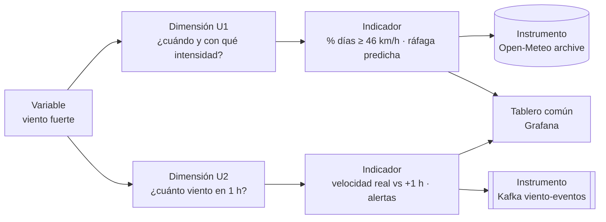

# Brief técnico-analítico

!!! info "Propósito"
    Declara por escrito el sistema Big Data que se construye en el ciclo. Se actualiza solo cuando cambia el alcance.

!!! warning "Cambio de alcance · noviembre 2026"
    La dimensión pasa de **precipitación** a **viento**. En época seca la lluvia en vivo vale 0 casi todo el tiempo y no daba señal en streaming; el viento cambia siempre y la misma API lo entrega en tiempo real.

## 1. Datos del equipo

-   :material-account:{ .lg .middle } **Integrante**

    ---

    **Efrain Nayder Arce Mayta** 
    Trabajo individual · construye la U1 y la U2 de punta a punta.

-   :material-source-repository:{ .lg .middle } **Repositorio**

    ---

    [kiohunter12/bigdata-viento-nayder](https://github.com/kiohunter12/bigdata-viento-nayder) 
    Sección: ⟨completar⟩

bigdatacampus-juliacasemestre-2026-2linea-cdiatipo-ps

| Integrante | Rol o énfasis |
|---|---|
| Efrain Nayder Arce Mayta | Batch con Spark (U1) · streaming con Kafka, observabilidad y BI/ML (U2) |

## 2. Dominio del proyecto

!!! question "Pregunta central de negocio"
    **¿Cuándo y con qué intensidad sopla el viento fuerte en el Altiplano de Juliaca, y cuánto viento habrá en la próxima hora para avisar a tiempo a los productores?**

Proyecto
:   ClimateRisk Andes

Problema
:   En el Altiplano (Juliaca, Puno, Lampa) el viento fuerte daña cultivos y coberturas y afecta la elaboración de chuño; los productores no cuentan con un aviso local y oportuno.

Dominio de datos
:   Meteorología: velocidad, dirección y ráfaga del viento a 10 m, más temperatura, humedad, presión y nubosidad.

Usuarios
:   Productores agrícolas suscritos (reciben alertas) · analista de riesgo (tablero Grafana) · sistema automático de alertas.

Arquitectura
:   **Lambda**: el histórico de 16 años se recalcula completo en batch y alimenta a la capa en tiempo real con el umbral p90 y los modelos entrenados.

Continuidad
:   Continuación del proyecto ClimateRisk Andes de la U1 (2026-2), con cambio de dimensión.

### Fuentes de datos

=== ":material-database: Batch"

    **API Open-Meteo · Historical Weather (reanálisis ERA5)**

    - Punto: Juliaca (-15.50082, -70.13980)
    - Frecuencia: horaria, desde 2010-01-01
    - Volumen: 147 432 registros

=== ":material-access-point: Tiempo real"

    **API Open-Meteo · Forecast `current`** (se recalcula cada 15 min)

    - Puntos: Juliaca, Puno y Lampa
    - Camino: productor → MQTT (Mosquitto) → bridge → Kafka `viento-eventos`
    - Eventos de negocio: `suscripcion.creada`, `alerta.emitida`, `alerta.notificada`

!!! note
    Es el mismo origen visto en dos momentos: el histórico acumulado y la lectura en vivo.

## 3. Dimensiones de análisis

| Tipo | Dimensión | Indicador | Fuente batch | Fuente streaming |
|---|---|---|---|---|
| **Predictiva U1** · batch | ¿En qué meses y horas hay ráfagas fuertes y cuál será la ráfaga máxima de hoy? | % de días con ráfaga ≥ 46 km/h por mes · ráfaga máxima predicha · probabilidad de día fuerte | Open-Meteo archive horario | no aplica |
| **Predictiva U2** · streaming | ¿Cuánto viento habrá en la próxima hora y cuándo supera el umbral? | velocidad real vs +1 h por estación · alertas · MAE en producción | histórico ERA5 (entrenamiento) | Kafka `viento-eventos` |

### :material-numeric-1-circle: Dimensión U1 · climatología y ráfaga diaria

| Campo | Detalle |
|---|---|
| Tipo | Predictiva sin tiempo real (batch) |
| Dimensión | ¿En qué meses, horas y desde qué dirección sopla más fuerte el viento, y se puede estimar la ráfaga máxima de hoy con lo que pasó ayer? |
| Indicadores | % de días fuertes por mes · hora pico · rumbo dominante · ráfaga predicha · probabilidad de día fuerte |
| Decisión habilitada | Planificar labores sensibles (coberturas, secado de chuño, fumigación) en los meses y horas de menos viento |
| Instrumento | Open-Meteo archive: `fecha_hora`, `temperatura`, `humedad`, `presion`, `nubosidad`, `velocidad`, `direccion`, `rafaga` |
| Modelo | Regresión (LinearRegression, RandomForest) y clasificación (LogisticRegression con pesos) en Spark MLlib, ejecutados una vez |
| Salida | Notebook `01_viento_batch_nayder.ipynb` + Gold Parquet particionado por año |
| Combinación | KPIs batch (ráfaga media del mes, probabilidad de día fuerte, umbral) en el tablero Grafana |

!!! success "Requisitos U1"
    - [x] El sistema debe descargar y procesar el histórico de forma reproducible con PySpark.
    - [x] El sistema debe validar la calidad (nulos, duplicados, rangos) y guardar Parquet particionado.
    - [x] El sistema debe calcular el umbral de ráfaga fuerte y entrenar, comparar y guardar un modelo predictivo.

### :material-numeric-2-circle: Dimensión U2 · viento en la próxima hora y alertas

| Campo | Detalle |
|---|---|
| Tipo | Predictiva con tiempo real (streaming) |
| Dimensión | ¿Cuánto viento habrá en la próxima hora en cada estación y cuándo supera el umbral de alerta? |
| Indicadores | velocidad real vs +1 h · alertas emitidas y notificadas · MAE en producción · latencia y validez del flujo |
| Decisión habilitada | Avisar a los productores suscritos antes del viento fuerte |
| Instrumento | `viento-eventos` (contrato `viento.lectura` v1) y `alerta-eventos` (eventos de negocio) |
| Modelo | Serie de tiempo (velocidad t+1 h) con RandomForest MLlib, aplicado en vivo sobre el stream |
| Salida | Tablero Grafana *Viento Juliaca — Pipeline U2* |
| Combinación | Comparte tablero con los KPIs batch de la U1 |

!!! success "Requisitos U2"
    - [x] El sistema debe ingerir lecturas reales y eventos de negocio por Kafka con contratos versionados.
    - [x] El sistema debe procesar el stream con ventanas, watermark, checkpoint y deduplicación.
    - [x] El sistema debe predecir en vivo, exponer métricas en Grafana y medir el error en producción.

## Alcance

!!! tip "Qué SÍ cubre"
    - Viento en 3 puntos del Altiplano (Juliaca, Puno, Lampa)
    - Histórico horario 2010 → hoy
    - Alertas por umbral y notificación a suscritos
    - Predicción a 1 hora en vivo

!!! failure "Qué NO cubre"
    - Sensores físicos propios (la fuente es un modelo meteorológico, no un anemómetro)
    - Pronósticos a más de 1 hora
    - Envío real de SMS

## 4. Aprobación

| Docente | Fecha |
|---|---|
| Abel Angel Sullon Macalupu | ⟨completar⟩ |
