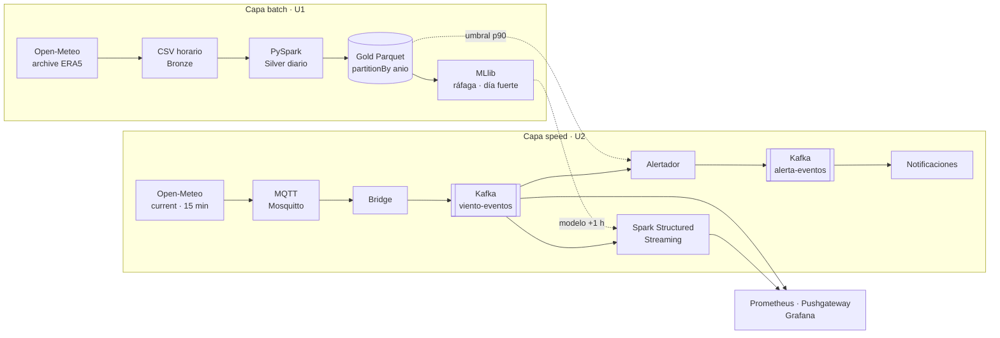

---
hide:
  - navigation
  - toc
---

# ClimateRisk Andes · Viento

Pipeline Big Data **Lambda** para anticipar el viento fuerte en el Altiplano de Juliaca. 
**Efrain Nayder Arce Mayta** · Big Data 2026-2 · Universidad Peruana Unión

:material-help-circle-outline: **Pregunta central** — ¿Cuándo y con qué intensidad sopla el viento fuerte en el Altiplano de Juliaca, y cuánto viento habrá en la próxima hora para avisar a tiempo a los productores?

[Ver el brief :material-arrow-right:](brief.md){ .md-button .md-button--primary }
[Repositorio :fontawesome-brands-github:](https://github.com/kiohunter12/bigdata-viento-nayder){ .md-button }

## Resultados en una mirada

  

147 432

horas de histórico procesadas (2010 → 2026)

  

46 km/h

umbral de ráfaga fuerte (p90)

  

+15.5 %

mejora del modelo a 1 h sobre la persistencia

  

3.65

MAE en producción (km/h) vs 3.92 de persistencia

  

100 %

eventos válidos en el stream

  

≈ US$ 91

costo mensual estimado en la nube

## Arquitectura Lambda

## Lo que entrega el proyecto

-   :material-database-cog:{ .lg .middle } **Producto U1 · Batch**

    ---

    ETL distribuido con PySpark, calidad de datos, Parquet particionado, joins y ventanas, regresión y clasificación con MLlib.

    [:octicons-arrow-right-24: Ver producto U1](u1-producto.md)

-   :material-lightning-bolt:{ .lg .middle } **Producto U2 · Streaming**

    ---

    Kafka con eventos IoT y de negocio, Spark Structured Streaming, observabilidad, costos y predicción en vivo.

    [:octicons-arrow-right-24: Ver producto U2](u2-producto.md)

-   :material-file-document-check:{ .lg .middle } **Brief**

    ---

    Pregunta central, dimensiones, indicadores, fuentes y requisitos del sistema.

    [:octicons-arrow-right-24: Ver brief](brief.md)

-   :material-swap-horizontal:{ .lg .middle } **Contratos de eventos**

    ---

    Esquemas versionados de `viento.lectura`, `suscripcion.creada`, `alerta.emitida` y `alerta.notificada`.

    [:octicons-arrow-right-24: Ver contratos](contratos.md)

## Hallazgos principales

=== "Climatología (U1)"

    

    - Más días de ráfaga fuerte entre **setiembre y noviembre** (22–23.5 %); marzo y abril son los más calmos.
    - El viento se arma con el calentamiento de la tarde: **pico a las 17:00**.
    - El **41 %** del viento sopla desde el **suroeste y oeste**.

=== "Modelos (U1)"

    

    - Clasificación de día fuerte: regresión logística con pesos, **AUC 0.775** y **recall 67 %** (persistencia: 46 %).
    - *Drift*: en el entrenamiento solo el 8 % de los días eran fuertes y en el test, el 22 %.

=== "Tiempo real (U2)"

    | Modelo · velocidad +1 h | RMSE | MAE | R² |
    |---|---|---|---|
    | Persistencia | 3.75 | 2.58 | 0.53 |
    | Regresión lineal | 3.33 | 2.34 | 0.63 |
    | **Random forest** | **3.16** | **2.25** | **0.66** |

    En producción el modelo gana a la persistencia en Juliaca y Puno; en Lampa sobrestima las noches de calma.

=== "Operación (U2)"

    - Latencia publicación → procesado: **p50 2.9 s · p95 8.5 s** (acotada por el trigger de 10 s).
    - Tolerancia a fallos demostrada con checkpoint, watermark y deduplicación.
    - Problema de archivos pequeños visto en vivo (**2 172 → 1** al compactar).
