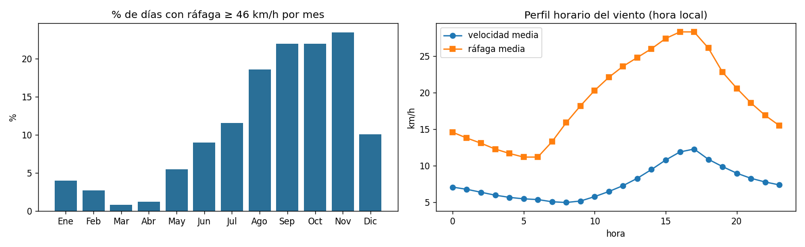
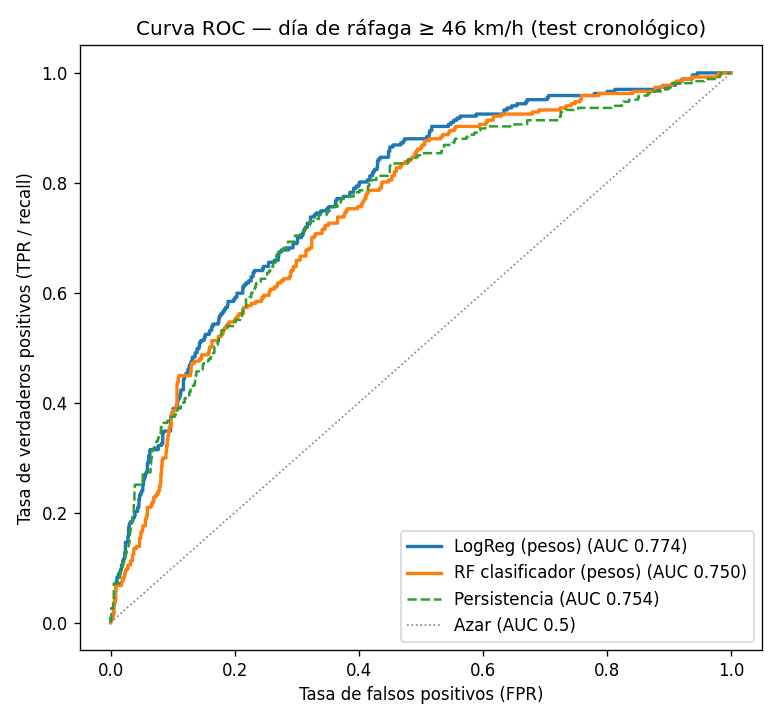

# ClimateRisk Andes · Dimensión Viento

**Efrain Nayder Arce Mayta** · Big Data 2026-2 · UPeU · Repositorio: <https://github.com/kiohunter12/bigdata-viento-nayder>

**Pregunta central:** ¿Cuándo y con qué intensidad sopla el viento fuerte en el Altiplano de Juliaca, y cuánto viento habrá en la próxima hora para avisar a tiempo a los productores?

## Arquitectura Lambda

```
U1 batch   Open-Meteo archive ──► CSV ──► PySpark (Bronze→Silver→Gold Parquet/anio) ──► MLlib (ráfaga diaria, día fuerte)
U2 speed   Open-Meteo current ──► MQTT (Mosquitto) ──► bridge ──► Kafka viento-eventos ──► Spark Structured Streaming
                                                         │        └► alertador ─► alerta-eventos ◄─ suscripciones ─► notificaciones
                                                         └► kafka-exporter ─► Prometheus ◄─ Pushgateway ◄─ Spark ─► Grafana
```

## Resultados clave

| | Resultado |
|---|---|
| Datos U1 | 147 432 horas (2010 → oct-2026), 0 nulos, 0 duplicados, Gold en 17 particiones |
| Umbral de ráfaga fuerte | **46 km/h** (p90); más días fuertes en set–nov (≈ 23 %), pico a las 17 h, viento del SO/O |
| Modelo U1 (clasificación) | LogReg con pesos: AUC 0.775 vs persistencia 0.755, recall 67 % |
| Modelo U2 (velocidad +1 h) | RandomForest RMSE 3.16 vs persistencia 3.75 (**+15.5 %**) |
| Producción | MAE 3.65 vs persistencia 3.92 (**−7 %**); Lampa con sesgo en calma |
| Operación | latencia p95 8.5 s, 100 % eventos válidos, costo ≈ US$ 91/mes |





## Documentos
- [Brief](brief.md)
- [Producto U1](u1-producto.md)
- [Producto U2](u2-producto.md)
- [Contratos de eventos](contratos.md)
